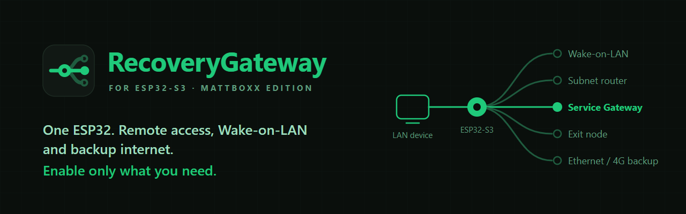
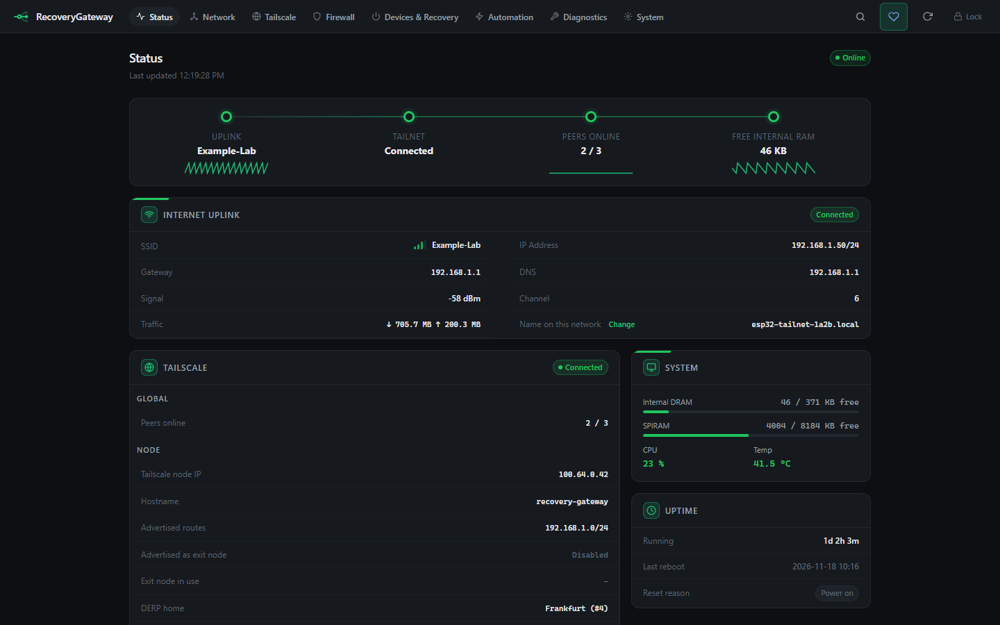
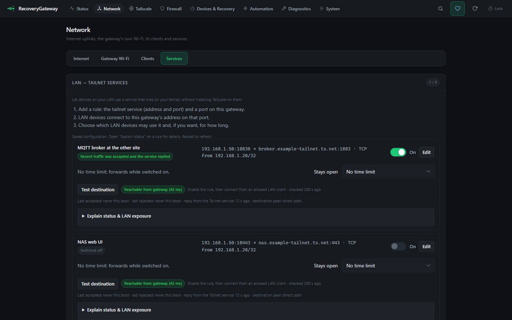
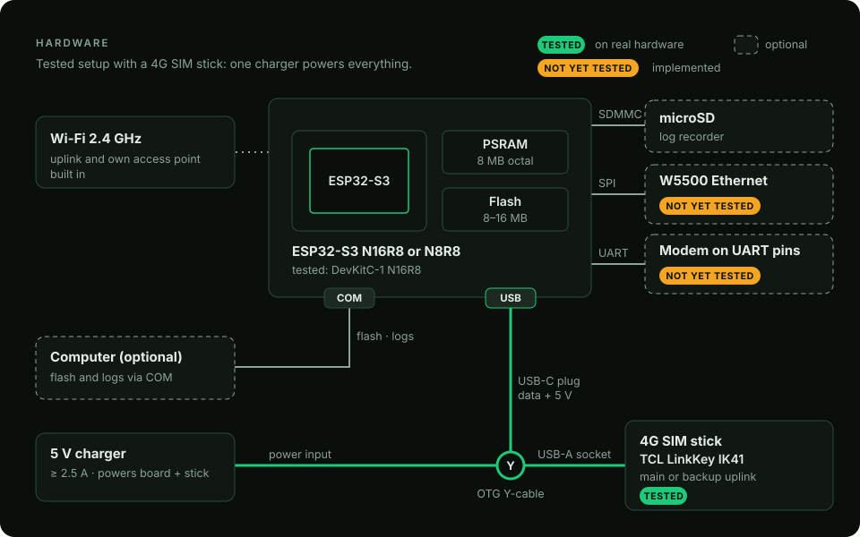

# ESP32 Tailnet Gateway 

**Mattboxx Edition · One ESP32. Remote access, Wake-on-LAN and backup internet. Enable only what you need.**

**Tailscale / Headscale gateway · Wake-on-LAN from Telegram or ntfy, no VPN needed · Ethernet and 4G/LTE uplinks for IoT**

Use it as a Tailnet gateway, as a stand-alone Wake-on-LAN node you command
from Telegram or ntfy, or as an IoT gateway that stays online over Ethernet
or a mobile SIM when Wi-Fi drops. Each role is optional: you do not need
Tailscale to use Wake-on-LAN or the backup uplinks.

**ESP32-S3 N8R8 / N16R8 · 8 MB octal PSRAM**

[Install in your browser](https://mattboxx.github.io/esp32-tailnet-gateway/install-firmware/) ·
[Download firmware](../../releases/latest) ·
[Setup guide](docs/GETTING-STARTED.md) ·
[Website](https://mattboxx.github.io/esp32-tailnet-gateway/)

## What you can do

| Use case | What the ESP32 does |
| --- | --- |
| **Wake and check a NAS or PC — no VPN needed** | Send Wake-on-LAN and verify that the device answers, from a Telegram bot or an ntfy topic. Works with or without Tailscale. [Setup and command reference](https://mattboxx.github.io/esp32-tailnet-gateway/remote-recovery/#commands). |
| **Keep IoT devices online** | Use a mobile SIM or wired Ethernet as the main or the backup uplink, with automatic failover and an optional monthly data limit. **SIM:** a 4G/LTE modem wired to the board's pins (UART, e.g. SIM7600 or A7670 modules), or plugged into its USB port (USB LTE modems and 4G sticks, beta). **Ethernet:** a W5500 module on the pins (SPI), or a USB Ethernet adapter or phone tethering on the USB port (beta). [Hardware](https://mattboxx.github.io/esp32-tailnet-gateway/hardware/) · [USB devices](docs/USB-DEVICES.md). |
| **Connect devices that cannot run Tailscale** | Forward one TCP or UDP service from the local LAN to a Tailnet peer. Restrict the source by IP/CIDR. |
| **Reach a remote LAN** | Advertise approved subnets to Tailnet clients. Configure the gateway's own Wi-Fi for IoT devices. |
| **Monitor and automate** | Track events and resource trends locally. Optionally use MQTT and Home Assistant, ntfy, Telegram, email or SNMP. |

## Quick start

1. **Check your board.** Use an ESP32-S3 N8R8 or N16R8 with 8 MB octal PSRAM. See [supported hardware](#8-supported-hardware).
2. **Install.** Open the [Web Installer](https://mattboxx.github.io/esp32-tailnet-gateway/install-firmware/) in desktop Chrome or Edge with a USB data cable. You can also use [Easy Install or the advanced downloads](#7-download-firmware).
3. **Set up.** Join the board's `ESP32-Tailnet-Setup-XXXX` Wi-Fi, go to http://192.168.4.1, pair using the BOOT button or USB setup code, and test your uplink. Open the address shown at the end of the wizard.
4. **Join your Tailnet.** Connect to Tailscale or Headscale, then enable the role you need.

[First-boot walkthrough](docs/GETTING-STARTED.md) · [Update an existing gateway](https://mattboxx.github.io/esp32-tailnet-gateway/updating/)

## LAN → Tailnet Service Gateway

For example, a home automation controller at a second site can send MQTT
messages to a broker on your Tailnet. The controller connects to the ESP32's
LAN address. The ESP32 forwards the connection to the broker using one rule
that specifies the destination, protocol, port and allowed source.

[Configure your first service rule](docs/SERVICE-GATEWAY.md) ·
[MQTT between two homes](https://mattboxx.github.io/esp32-tailnet-gateway/mqtt-across-networks/)

## Web interface

Screenshots show the embedded Firmware 3.0.19 interface with fictional
configuration, peers and measurements. Open an image for the full view.

| Status | Service Gateway |
| --- | --- |
|  |  |

[Browse the gallery](https://mattboxx.github.io/esp32-tailnet-gateway/screenshots/) for mobile, first boot, recovery, alerts, firewall and diagnostics.

## What's new in Firmware 3.0.26

- **Fix for tailnets with recently added devices**: their new 64-bit device IDs
  made the gateway refuse the device list and block the tunnel.
- **Headscale with a private CA or a self-signed certificate.**
- **First connection without working DNS**, **ACL "cap:" rules**, two relays
  to other regions at once.
- **LAN → Tailnet**: up to 5 allowed devices per rule, and a guide to
  [share one service with another network](docs/SERVICE-GATEWAY.md).
- **Configuration profiles** for every first-boot goal.

### Also in 3.0.25

- **Tailscale access fixes:** single-use auth keys no longer take the gateway
  offline after it joined, there is no 16-device limit, and a gateway alone in
  its tailnet, networks that block port 80 or NTP, DNS failures and ACL rules
  with node capabilities no longer block the tailnet.
- **Clear Tailscale status:** why the gateway is not connected, node key
  expiry, Tailnet Lock, peers and tunnels in use; a **Leave tailnet** button.
- **LAN → Tailnet** tab redesigned, with a simple time limit per rule.
- **Logs with date and time.**
- **USB modems, 4G sticks and Ethernet adapters** (experimental, see below).

[Install the current firmware](https://mattboxx.github.io/esp32-tailnet-gateway/install-firmware/)
· [Full changelog](CHANGELOG.md)

## Downloads

| Method | Use it for |
| --- | --- |
| [Web Installer](https://mattboxx.github.io/esp32-tailnet-gateway/install-firmware/) | First install from desktop Chrome or Edge over USB |
| [Easy Install](https://mattboxx.github.io/esp32-tailnet-gateway/easy-install/) | Guided USB setup on Windows, macOS or Linux |
| [GitHub Releases](../../releases/latest) | OTA image, factory image, checksums, provenance and license notices |

To update an existing gateway, use **System → Firmware**. Factory installs
can erase settings. See [the update and rollback guide](https://mattboxx.github.io/esp32-tailnet-gateway/updating/)
and verify release files against `SHA256SUMS.txt`.
For the historical 3.0.2 notice bundles, see [their separate checksums](licenses/releases/v3.0.2/LICENSE-SHA256SUMS.txt).

## Supported hardware

Firmware 3.x runs on **ESP32-S3 with 8 MB octal PSRAM and at least 8 MB of
quad flash**:

| Supported | Not supported |
|---|---|
| **N16R8** — e.g. ESP32-S3-DevKitC-1 N16R8, WROOM-1/1U-N16R8 (**tested**) | 4 MB flash (N4…) |
| **N8R8** — e.g. ESP32-S3-DevKitC-1 N8R8, WROOM-1/1U-N8R8, Freenove N8R8, Seeed XIAO ESP32S3 (same layout, not yet tested on 3.x) | R2 or no PSRAM, octal-flash modules (WROOM-2, N16R16V, N32R8V), other ESP32 chips |

Details and community reports: [Hardware](docs/HARDWARE.md).

### USB modems, 4G sticks and Ethernet adapters (experimental, from 3.0.25)

Besides a W5500 module or a modem wired to the pins, the gateway can use one
USB device on the board's **USB** port (not the COM port): a USB LTE modem or
4G stick with a SIM, a USB Ethernet adapter (Realtek RTL8152/8153/8156,
CDC-ECM/NCM) or Android USB tethering. Choose *USB* in first-boot setup or on
the Network page, save, restart, then plug the device. Not yet tested with real
devices.

- **The board does not supply 5 V on its USB port.** Use a powered USB-C OTG
  Y-cable with a 5 V charger (at least 2.5 A for a modem or stick), or the
  device's own 5 V supply with grounds connected. LTE modems draw **up to 2 A**
  in bursts: a computer's USB port is not enough (modem resets, reset reason
  BROWNOUT).
- Never connect two 5 V sources together: if you bridge the board's USB-OTG
  pad, never plug that port into a computer or charger.
- After the restart the USB port is a USB host: flash, logs and power go
  through the COM port. One device, no hubs, about 10 Mbit/s at most.
- **While a USB connection is on, the Wi-Fi keeps 16 receive buffers instead of
  24** to leave internal RAM for the device. Bursts of Wi-Fi traffic, such as
  a speed test from a phone on the gateway's access point, can be slower or
  lose more packets; ordinary use was unchanged in measurements. With the pins
  or with these uplinks off, nothing changes.

Full guide: [USB devices](https://mattboxx.github.io/esp32-tailnet-gateway/usb-devices/)
· [docs/USB-DEVICES.md](docs/USB-DEVICES.md).

## Documentation

| Area | Start here |
| --- | --- |
| Setup, hardware and configuration | [Getting started](docs/GETTING-STARTED.md) · [Hardware](docs/HARDWARE.md) · [Configuration](docs/CONFIGURATION.md) |
| Networking | [Service Gateway](docs/SERVICE-GATEWAY.md) · [Network modes](https://mattboxx.github.io/esp32-tailnet-gateway/network-modes/) · [Dynamic DNS](docs/DDNS.md) |
| Recovery and automation | [NAS recovery](docs/NAS-RECOVERY.md) · [Smart Recovery](docs/SMART-RECOVERY.md) · [Automation](https://mattboxx.github.io/esp32-tailnet-gateway/automation/) |
| Operations | [Security policy](SECURITY.md) · [Diagnostics](https://mattboxx.github.io/esp32-tailnet-gateway/diagnostics/) · [Release history](CHANGELOG.md) |
| Development | [Documentation index](docs/README.md) · [Testing](docs/TESTING.md) · [Wiki](https://github.com/Mattboxx/esp32-tailnet-gateway/wiki) |

## Security

- PBKDF2-HMAC-SHA256 password verifier with a one-time login challenge,
  device-wide login budget, `SameSite=Strict` session cookie.
- State-changing requests are screened against cross-origin and cross-site
  use; untrusted `Host` names are refused when no password is set (DNS
  rebinding).
- First boot is restricted to the setup AP, requires physical pairing and
  seals setup requests with X25519/AES-256-GCM. It does not authenticate the
  downloaded page against an active nearby impersonator; use a trusted setup site.
- Tailnet authorization is checked on original packets before NAT, fails
  closed on malformed or revoked policy and is not a claim of full
  official-client policy parity.
- A Service Gateway source filter is **not** client identity: prefer `/32`.
- The local Web UI is HTTP; administer it from a trusted LAN/AP or over the
  tailnet. The portable image does not enable Secure Boot or flash encryption.

Report vulnerabilities privately: see [SECURITY.md](SECURITY.md).

## Limits

- **Estimated peak Tailnet transfer speed:** roughly **8 Mbit/s (1 MB/s)**
  over a direct Wi-Fi tunnel in favorable conditions. A W5500 Ethernet
  uplink may improve that by removing Wi-Fi airtime contention. The
  firmware's sustained Ethernet ceiling remains unmeasured. Relay paths
  and concurrent traffic can reduce throughput.
- **Service Gateway scope:** IPv4 TCP/UDP, up to 8 rules, one Tailnet IPv4
  destination per rule; a port forwarder, not transparent routing. UDP cannot
  be verified without an application reply.
- **Exit node:** IPv4 only; IPv6 fails closed. A selected exit node fails
  closed when unreachable.
- **Not supported:** tailnet lock; Headscale with self-signed certificates.
- **Experimental hardware:** W5500 requires compatible hardware and pin settings.
  This embedded community client does not promise full official-client policy parity.
  See [release availability](docs/PRESENTATION-STATUS.md).

## Contributing

Bug reports, hardware reports and guide improvements are welcome. Read
[CONTRIBUTING.md](CONTRIBUTING.md) and the [code of conduct](CODE_OF_CONDUCT.md);
use the issue templates. Follow the checks in [Testing](docs/TESTING.md) for
the published source.

Support the Mattboxx edition on GitHub Sponsors or Ko-fi — entirely optional.
The firmware and all features remain free:

## Credits and licences

GPL-3.0-only ([LICENSE](LICENSE)) with an additional permission for ESP-IDF and
Espressif's binary libraries and terms on attribution and on the Mattboxx name
([LICENSE-EXCEPTION.md](LICENSE-EXCEPTION.md)), for all Mattboxx code from
8 November 2026 and every release from 3.0.12. Releases up to 3.0.11 were
published under MIT and copies of them keep those terms. The original firmware's MIT notice is kept in
[licenses/upstream](licenses/upstream/esp32-tailscale-subnet-router-MIT.txt). Built on:

- **[Csontikka/esp32-tailscale-subnet-router](https://github.com/Csontikka/esp32-tailscale-subnet-router)** —
  the original firmware this edition builds on. Support the upstream author via
  [GitHub Sponsors](https://github.com/sponsors/Csontikka) or
  [Buy Me a Coffee](https://buymeacoffee.com/csontikka).
- **[Mattboxx/microlink](https://github.com/Mattboxx/microlink)** — the pinned
  networking dependency, derived through [Csontikka's fork](https://github.com/Csontikka/microlink)
  from **Cameron Malone's [original MicroLink](https://github.com/CamM2325/microlink)**.
  The current fork uses GPL-3.0-only with an ESP-IDF linking permission and
  preserves the original MIT and third-party notices. Previously published
  firmware retains the terms of the MicroLink revision it shipped.
- **[wireguard_lwip](https://github.com/smartalock/wireguard-lwip)** — Daniel Hope's
  userspace WireGuard for lwIP (BSD-3-Clause), with separately licensed crypto notices.
- **[ESP-IDF](https://github.com/espressif/esp-idf)** — Espressif SDK (primarily
  Apache-2.0; bundled libraries retain their own licenses).

Full attribution: [NOTICE.md](NOTICE.md). Brand assets: [assets/brand](assets/brand/BRAND.md).
Bundled third-party components and the separately distributed esptool
flashing program retain their respective licences.
ESP32 Tailnet Gateway is independent community firmware. It is not affiliated
with Tailscale Inc., the Headscale project or Espressif.
Tailscale, Headscale, WireGuard and ESP32 are trademarks of their respective
owners. Legacy README: [1.13 documentation](https://github.com/Mattboxx/esp32-tailnet-gateway/blob/v0.1.38-Mattboxx-1.13/README.md).
